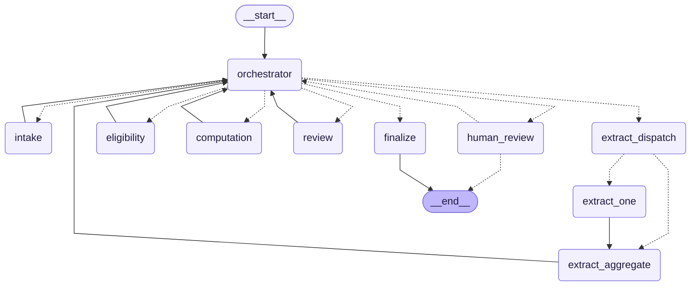

# Kushim SilverFile (Team 3)

SilverFile is a LangGraph multi-agent system that drafts **Form 1040-SR** for older adults served by Kushim Financial. A taxpayer answers plain-language questions one at a time, and their documents are read, including a W-2 from a photo. Eligibility is decided from a cited policy, and every dollar is computed by a deterministic tax_math tool. An independent Review agent then tries to prove the return wrong. Anything unusual (advice requests, possible exploitation, out-of-scope income, conflicting documents) stops the run and goes to a Kushim volunteer in a staff dashboard. The result is a draft 1040-SR in which every number shows where it came from. Built for Cornell ENMGT 5405, Assignment 7.

> SilverFile is a preparation aid. It never files anything and never gives tax advice. Its output is a draft return plus an audit record for a volunteer to review.

Each finished session writes to `outputs/<session_id>/`:
- `form_1040sr.html`: the draft in 1040-SR order. Hover over, tab to or click any amount to see its formula, sources and who entered it.
- `form_1040sr.pdf`: the official IRS 2025 Form 1040-SR, filled in and watermarked "CLASSROOM DRAFT - DO NOT FILE".
- `audit.json`: every line with provenance, the cited rules, volunteer decisions and review rounds.

## Team roles

| Focus area | Team member assigned | Agent owned |
| --- | --- | --- |
| Agent memory | Mohammed | Intake |
| Inter agent communication | Hamdan | Document Extraction |
| Task division and management | Siddharth | Orchestrator |
| MLOps/DevOps | Parth | Computation |
| Guardrails and ethics | Ishitha | Eligibility & Rules |
| Security | Alan (SJAlanA) | Review / Audit |

## Setup (local)

Requires Python 3.11. Everything works offline with no API key.

```bash
git clone https://github.com/SJAlanA/kushim-silverfile-team3.git
cd kushim-silverfile-team3
python3.11 -m venv .venv
source .venv/bin/activate          # Windows: .venv\Scripts\activate
pip install -r requirements.txt
cp .env.example .env               # optional: add ANTHROPIC_API_KEY to use Claude
pytest                             # all tests pass offline
```

`make install` and `make test` do the same with the Makefile. W-2 images are read with `rapidocr` (installed by pip). Tesseract is used too if it is on your machine, but isn't required.

**Offline or online.** With no key, or with `SILVERFILE_OFFLINE=1`, every agent uses deterministic rules: OCR for the W-2, scripted questions, and the eligibility table alone. With `ANTHROPIC_API_KEY` set in `.env`:
- the W-2 is read by Claude's vision;
- Intake phrases each question with the model;
- Eligibility cross-checks its table against the policy.

`run.py` loads `.env` itself. The tax numbers are identical either way, because they come from the tax_math tools.

## Run the eval cases

Run from the repository root, because case files use relative document paths.

**Eval case 1: a clean return, no human needed.** Single, born 1958, one W-2 image, Social Security, interest and dividends.

```bash
python run.py --case demo/eval_case_1/case.json        # or: make demo1
```

Expect `Status: complete`, no HITL events, and the three output paths. Key lines: 6b 6,540; 11a 36,940; 12e 17,750; 13b 6,000; 15 13,190; tax 1,338; refund 662. Details: [demo/eval_case_1.md](demo/eval_case_1.md).

**Eval case 2: a human steps in.** A widow whose husband died in August 2025, so the filing status needs a volunteer.

```bash
python run.py --case demo/eval_case_2/case.json        # or: make demo2
```

Expect exactly one `FILING_STATUS_AMBIGUITY` event. The case file resolves it as the volunteer would (continue, filing status `mfj`, with a note), and the run completes with a refund of 1,200. To resolve it yourself in the dashboard instead, follow the click-by-click steps in [demo/eval_case_2.md](demo/eval_case_2.md).

**Every HITL condition.** `evals/cases.json` has one case per escalation condition (advice, someone else answering, an undescribed refund account, a 1099-R with box 2b, out-of-scope income and documents, a mismatched W-2, and more):

```bash
pytest tests/test_evals.py
```

## Answer the questions yourself

```bash
python run.py --interactive
```

Use made-up details: SilverFile only accepts test SSNs that start with 9, such as `903-45-6789`. Document paths can point at the demo files, for example `demo/w2_image_3.jpg` (a W-2 for Theo Brandt, 903-45-6789) and `data/fixtures/ssa1099_1.json`.

You can stop at any time with Ctrl-C. Every answer is saved, and SilverFile prints the command to carry on later:

```bash
python run.py --session <session_id>
```

A resumed session starts with a short recap of what's been covered.

## The staff dashboard

```bash
python run.py --dashboard                              # or: make dashboard
```

Open http://localhost:8000. The dashboard and any runs must use the same checkpoint database: `CHECKPOINT_DB` in `.env`, by default `silverfile_checkpoints.sqlite` in the repository root.

- **Sessions** groups every session into *Needs a human*, *In progress* and *Completed*, showing first name, status and open events.
- **Waiting for review** lists every open HITL event with its plain-language reason. Click **Resolve** to choose a decision:
  - **Continue**, optionally with corrected answers such as `filing_status = mfj`;
  - **Stop**, which ends the session for a volunteer to prepare by hand;
  - **Send back** to a named agent.

  Then add a note and your name, and **Save decision**. A paused `--interactive` run carries on by itself.
- **A session's page** shows the answers (SSNs masked), documents, every line with its working, the review result, volunteer decisions, and links to the HTML form, PDF and `audit.json`.

The dashboard has no login and listens only on this machine (`127.0.0.1`). See [SECURITY.md](SECURITY.md).

## Run with Docker

```bash
docker compose up                                                         # dashboard on http://localhost:8000
docker compose run --rm app python run.py --case demo/eval_case_1/case.json
docker compose run --rm app python run.py --case demo/eval_case_2/case.json
docker compose run --rm app python run.py --interactive
```

**After pulling new code, rebuild the image** with `docker compose build` (or `docker compose up --build`). `docker compose run` reuses an existing image, so without a rebuild it runs the old code.

The image runs offline by default and includes Tesseract. Both services share one checkpoint database volume, so a run paused on a HITL event can be resolved in the dashboard container. Forms are written to `./outputs` and traces to `./traces` on your machine. To use Claude in Docker, put the key in `.env` and run with `SILVERFILE_OFFLINE=0 docker compose up`. Makefile shortcuts: `make docker-build`, `make docker-up`, `make docker-demo1`, `make docker-test`.

## Context-window measurement

```bash
python run.py --batch                         # 10 taxpayers in one thread, with selective recall
python run.py --batch --no-context-strategy   # the same, carrying the whole history
python -m src.batch --write-metrics           # regenerate docs/metrics.md and the chart
```

Without the strategy, input per taxpayer grows 18.3x from the first to the last; with it, 1.3x. See [docs/metrics.md](docs/metrics.md).

## Repository layout

```
kushim-silverfile-team3/
├── run.py                   # CLI: --case, --interactive, --session, --batch, --dashboard
├── src/
│   ├── state.py             # shared state and order-independent reducers
│   ├── graph.py             # LangGraph wiring (hub, Send fan-out, human_review)
│   ├── messages.py          # validated agent-to-agent messages
│   ├── llm.py               # the one place the model is called; offline fallback
│   ├── memory.py            # SQLite checkpointer, resume summary, context strategy
│   ├── hitl.py              # HITL events
│   ├── guardrails.py        # advice, exploitation and scope detection; outgoing check
│   ├── security.py          # SSN gate, PII masking, injection scan
│   ├── agents/              # orchestrator, intake, extraction, eligibility, computation, review
│   ├── tools/               # tax_math MCP server and client, tracing
│   ├── form/                # HTML form, IRS PDF filling, audit.json
│   └── dashboard/           # Flask staff dashboard
├── data/
│   ├── policy.md            # reference corpus the Eligibility agent cites
│   ├── forms/f1040sr.pdf    # official IRS 2025 Form 1040-SR (fillable)
│   ├── fixtures/            # 1099 and SSA-1099 JSON fixtures, batch scenario
│   └── generate_fixtures.py # draws the W-2 images and writes the fixtures
├── demo/                    # eval cases 1 and 2, W-2 images
├── evals/cases.json         # one regression case per HITL condition
├── tests/
├── docs/                    # graph, metrics, implementation notes, per-area notes, AI disclosure
├── traces/                  # per-session JSONL traces (sample committed)
├── Dockerfile, docker-compose.yml, Makefile
└── SECURITY.md              # threat model and controls
```

## Orchestration diagram

Every agent returns to the orchestrator, which picks the next node from state. Dotted edges are conditional. `extract_dispatch` fans out one `extract_one` branch per document, and they all join at `extract_aggregate`. Design notes: [docs/notes/task_division_and_management.md](docs/notes/task_division_and_management.md). Rendered image: [docs/graph.png](docs/graph.png).



## AI accreditation

Code in this repository was written with Claude (Anthropic) as an AI coding assistant. Team members defined the requirements, directed the design, and reviewed, tested and validated all generated code, and take full responsibility for it. Details of how each member used AI are in [docs/AI_DISCLOSURE.md](docs/AI_DISCLOSURE.md).

## Docs

- [Implementation notes](docs/IMPLEMENTATION_NOTES.md): topology, loop guard, accessibility, volunteered-SSN handling
- Per-area design notes: [docs/notes/](docs/notes/)
- [Context-window metrics](docs/metrics.md)
- [Security and threat model](SECURITY.md)
- [Reference corpus (policy)](data/policy.md)
- [AI-use disclosure](docs/AI_DISCLOSURE.md)
