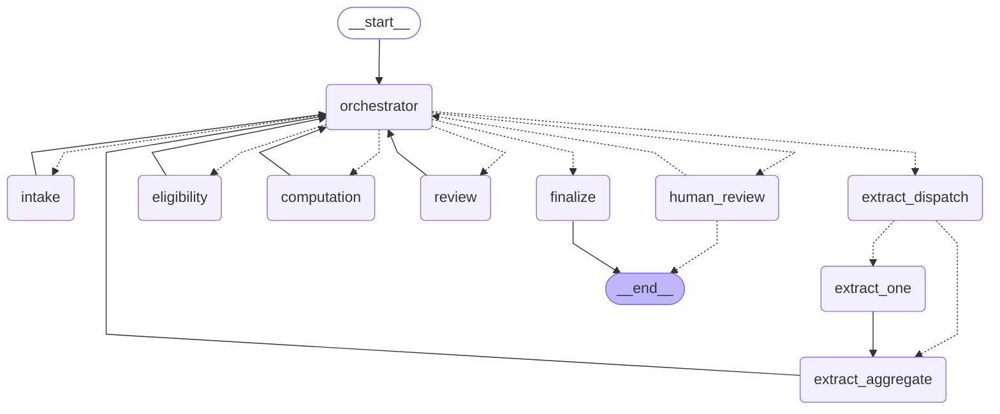

# Kushim SilverFile (Team 3)

SilverFile is a LangGraph multi-agent system that drafts Form 1040-SR for Kushim Financial, showing where every number came from, with human review of flagged cases and a staff dashboard. Built for Cornell ENMGT 5405, Assignment 7.

> SilverFile is a preparation aid. It never files anything and never gives tax advice. Its output is a draft return plus an audit record for a human to review.

## Team roles

| Focus area | Team member assigned | Agent owned |
| --- | --- | --- |
| Agent memory | Mohammed | Intake |
| Inter agent communication | Hamdan | Document Extraction |
| Task division and management | Siddharth | Orchestrator |
| MLOps/DevOps | Parth | Computation |
| Guardrails and ethics | Ishitha | Eligibility & Rules |
| Security | Alan (SJAlanA) | Review / Audit |

## Repository layout

```
kushim-silverfile-team3/
├── README.md
├── CONTRIBUTING.md          # branching and commit rules for the team
├── requirements.txt
├── .env.example
├── run.py                   # entry point (CLI)
├── src/
│   ├── state.py             # shared graph state + reducers
│   ├── graph.py             # LangGraph wiring
│   ├── memory.py            # checkpointer, resumability, context strategy
│   ├── agents/              # one file per agent
│   ├── tools/               # deterministic tax_math MCP server
│   └── dashboard/           # Kushim superuser dashboard
├── data/
│   ├── generate_fixtures.py
│   ├── policy.md            # reference corpus the Eligibility agent cites
│   └── fixtures/
├── evals/cases.json
├── tests/
├── traces/
├── docs/                    # graph.png, metrics.md, IMPLEMENTATION_NOTES.md, AI_DISCLOSURE.md
└── demo/                    # eval_case_1.md, eval_case_2.md, W-2 images, demo video
```

## Setup

Requires Python 3.11+.

```bash
git clone https://github.com/SJAlanA/kushim-silverfile-team3.git
cd kushim-silverfile-team3
python -m venv .venv
source .venv/bin/activate          # Windows: .venv\Scripts\activate
pip install -r requirements.txt
cp .env.example .env               # then add your API key
pytest                             # should pass (most tests are skipped until implemented)
```

## How to run

Everything runs offline with no API key: each agent falls back to deterministic rules.

```bash
python run.py --case demo/eval_case_1/case.json   # replay a case file end to end
python run.py --interactive                       # answer the questions yourself
python run.py --session <session_id>              # resume a saved session
python run.py --batch --no-context-strategy       # context-window measurement
python run.py --dashboard                         # staff dashboard on http://localhost:8000
```

When an interactive run raises a HITL event, it waits. Open the dashboard in a second terminal and resolve the event there, and the run carries on by itself.

## Orchestration diagram

Every agent returns to the orchestrator, which picks the next node from state. Dotted edges are conditional. `extract_dispatch` fans out one `extract_one` branch per document, and they all join at `extract_aggregate`. Design notes: [docs/notes/task_division_and_management.md](docs/notes/task_division_and_management.md). Rendered image: [docs/graph.png](docs/graph.png).



## AI accreditation

Code in this repository was written with Claude (Anthropic) as an AI coding assistant. Team members defined the requirements, directed the design, and reviewed, tested and validated all generated code, and take full responsibility for it. Details of how each member used AI are in [docs/AI_DISCLOSURE.md](docs/AI_DISCLOSURE.md).

## Docs

- [Implementation notes](docs/IMPLEMENTATION_NOTES.md)
- [Context-window metrics](docs/metrics.md)
- [AI-use disclosure](docs/AI_DISCLOSURE.md)
