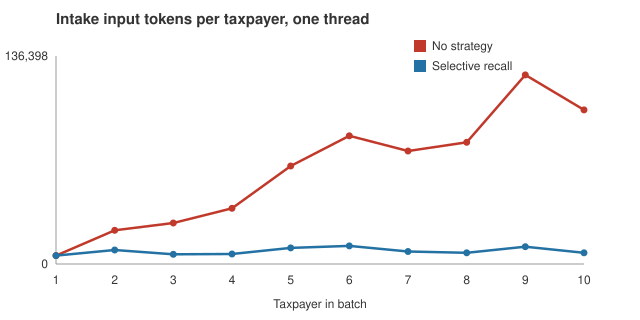

# Context-window metrics

Batch scenario (brief 4.5): 10 taxpayer intakes from `data/fixtures/batch/` run one after another in
one LangGraph thread. Each row is the total input tokens the Intake agent's model calls use for that
taxpayer (about 20 question turns each).

- **No strategy** (`python run.py --batch --no-context-strategy`): every prompt carries the whole
  thread history, so cost grows with every taxpayer already processed.
- **Strategy** (`python run.py --batch`): selective recall. Each prompt carries only the current
  taxpayer's messages plus a rolling decisions summary capped at the last five taxpayers.

Offline run: counts are estimated as `len(prompt) // 4` over the exact prompt Intake would send. Regenerate with `python -m src.batch --write-metrics`.

Taxpayers need different numbers of questions, so the last two columns divide by the number of
Intake model calls for that taxpayer. That per-question view shows the shape most clearly: it climbs
steadily with no strategy and stays flat with selective recall.

| # | Item | Questions | Input tokens (no strategy) | Input tokens (strategy) | Per question (no strategy) | Per question (strategy) |
| --- | --- | --- | --- | --- | --- | --- |
| 1 | batch_01 | 16 | 5,525 | 5,525 | 345 | 345 |
| 2 | batch_02 | 22 | 22,048 | 9,166 | 1,002 | 416 |
| 3 | batch_03 | 16 | 26,803 | 6,339 | 1,675 | 396 |
| 4 | batch_04 | 16 | 36,437 | 6,517 | 2,277 | 407 |
| 5 | batch_05 | 22 | 64,174 | 10,511 | 2,917 | 477 |
| 6 | batch_06 | 23 | 83,935 | 11,862 | 3,649 | 515 |
| 7 | batch_07 | 17 | 73,935 | 8,189 | 4,349 | 481 |
| 8 | batch_08 | 16 | 79,666 | 7,327 | 4,979 | 457 |
| 9 | batch_09 | 22 | 123,766 | 11,339 | 5,625 | 515 |
| 10 | batch_10 | 16 | 100,835 | 7,306 | 6,302 | 456 |

| | No strategy | Strategy |
| --- | --- | --- |
| First item | 5,525 | 5,525 |
| Last item | 100,835 | 7,306 |
| Growth, last / first | 18.3x | 1.3x |
| Total | 617,124 | 84,081 |

